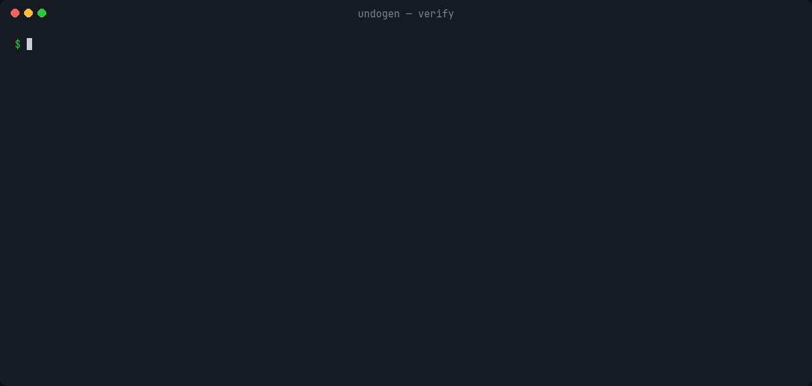

# undogen

[](https://github.com/anup2k13/undogen/actions/workflows/ci.yml)
[](LICENSE)

**Compile undo operations from any OpenAPI spec, then prove they actually work.**



AI agents now call real APIs: they open issues, change settings, and delete records. Most "undo for agents" tools ask you to write an inverse for each tool by hand, and nobody checks that those inverses work. An undo button that silently does the wrong thing is worse than having none.

undogen does two things:

1. **Compile.** It reads an OpenAPI spec and derives the undo for every write operation. A `POST` that creates something is undone by the matching `DELETE`. A `PATCH` snapshots the old values and writes them back. Paired actions like `archive`/`unarchive` undo each other, and endpoints that can't be called back (sending email, moving money) are flagged as irreversible.
2. **Verify.** It runs each operation, then its compiled inverse, against a test server. It diffs the state before and after. An inverse is marked *verified* only when the state is equivalent again.

```
$ undogen verify openapi.yaml --base-url http://localhost:4010

  ✓ createTodo     POST   /todos                                reversible   state restored exactly
  ✓ replaceTodo    PUT    /todos/{todoId}                       reversible   state restored exactly
  ✓ updateTodo     PATCH  /todos/{todoId}                       reversible   state restored exactly
  ✗ deleteTodo     DELETE /todos/{todoId}                       compensable  2 difference(s) remain after undo
      GET /todos/{todoId}/comments
        $[0]          {"text":"Looks good to me"}  →  (missing)
      GET /todos/{todoId}/comments/{commentId}
        status        200  →  404
  ✗ archiveTodo    POST   /todos/{todoId}/archive               reversible   2 difference(s) remain after undo
      GET /todos
        $[0].done     false  →  true
      GET /todos/{todoId}
        $.done        false  →  true
  ✓ unarchiveTodo  POST   /todos/{todoId}/unarchive             reversible   state restored exactly
  ⛔ sendReminder   POST   /todos/{todoId}/send-reminder         irreversible never executed; blocked at runtime unless approved
  ✓ createComment  POST   /todos/{todoId}/comments              reversible   state restored exactly
  ✓ deleteComment  DELETE /todos/{todoId}/comments/{commentId}  compensable  state restored (resource re-created under a new id)

  6 verified · 2 failed · 1 gated · 0 errors · 0 skipped
```

Both failures are real bugs, and nothing in the spec reveals them:

- **Cascading delete.** Deleting a todo also deletes its comments. Re-creating the todo can never bring them back.
- **Hidden side effect.** `archive` also sets `done: true`, and `unarchive` doesn't reset it.

Reading the spec, the compiler believes both inverses are correct. Only running them shows they aren't. That's why undogen has a verifier.

## Try it

```bash
git clone https://github.com/anup2k13/undogen && cd undogen
npm install
npm run demo        # starts a demo API, compiles, runs an agent session, verifies
```

## Use it

> undogen is not on npm or PyPI yet. Until the first release (see `.github/workflows/release.yml`), run it from a clone: `npm install && npm run build && node dist/cli.js …`, and `pip install ./python`.

### 1. See what's undoable in an API

```bash
npx undogen analyze openapi.yaml      # OpenAPI 3.x or Swagger 2.0, local file or URL; external $refs are followed
```

```
  createTodo     POST   /todos             reversible   delete-created          0.90
      ↺ undo     DELETE /todos/{todoId}  todoId ← response.id
  updateTodo     PATCH  /todos/{todoId}    reversible   restore-snapshot        0.90
      ◉ capture  GET /todos/{todoId}
      ↺ undo     PATCH /todos/{todoId}  body ← before[keys sent]
  deleteTodo     DELETE /todos/{todoId}    compensable  recreate-from-snapshot  0.65
      ◉ capture  GET /todos/{todoId}
      ↺ undo     POST /todos  body ← before.{title,done}
      ⚠ The re-created resource gets a new identifier
  sendReminder   POST   /todos/{todoId}/send-reminder   irreversible
```

No network calls are made. Add `--json` for machine-readable plans.

### 2. Prove the inverses against a sandbox

```bash
npx undogen verify openapi.yaml --base-url https://sandbox.example.com \
  --header "authorization: Bearer $TOKEN" \
  --report ./undogen-report
```

For each write operation, `verify`:

- **creates real resources** for every path parameter, parents first;
- **seeds child resources** (one comment per todo, and so on), so cascading deletes have something to destroy;
- **generates request bodies that actually change state**, and **checks that they did**: if the operation changed nothing visible, the result is `inconclusive`, never `verified`;
- **snapshots every readable route**, runs the operation and its inverse, snapshots again, and diffs;
- **probes created resources directly**, so a create is tested even when the API has no list route;
- **follows identity changes** for compensable inverses: when a deleted record is re-created under a new id, it compares by content;
- **never executes** operations classified as irreversible;
- **deletes everything it created** afterwards (`--keep` to inspect it).

The exit code is `1` when any inverse fails (`--strict`: or is inconclusive), so it works as a CI gate. `--report` writes `report.json`, `report.md`, and a [shields.io endpoint badge](https://shields.io/badges/endpoint-badge) (`badge.json`); `--junit` and `--sarif` write JUnit XML and SARIF 2.1.0 for CI test views and code scanning. Values under secret-looking keys are always masked in reports; `--redact` masks everything.

On a shared sandbox, `--scoped-only` snapshots only routes scoped to the resources verify created, so other people's activity can't fail the run.

> ⚠️ `verify` creates and deletes data. Point it at a sandbox, never at production.

Add `--restore-children` and the cascading delete above stops being a failure: before deleting a todo, undogen captures its comments, and the undo re-creates them under the re-created todo:

```
$ undogen verify openapi.yaml --base-url http://localhost:4010 --restore-children --only deleteTodo
  ✓ deleteTodo    DELETE /todos/{todoId}  compensable  state restored (2 resources re-created under new ids)
```

It's opt-in because re-created children get new ids and the caller as their author.

### 3. Give agents an undo button

```ts
import { loadSpec, UndoableClient, FileJournalStore, IrreversibleOperationError } from 'undogen';

const spec = await loadSpec('openapi.yaml');
const client = await UndoableClient.open({
  spec,
  baseUrl: 'https://api.example.com',
  headers: async () => ({ authorization: `Bearer ${await getToken()}` }), // or a static object
  // Irreversible calls are blocked unless this approves them (human-in-the-loop, policy engine...)
  allowIrreversible: async (op, plan, input, { replayOf }) => askHuman(`Allow ${op.id}? ${plan.reasons[0]}`),
  store: new FileJournalStore('.undogen/journal.jsonl'), // optional: survives restarts
});

await client.call('createTodo', { body: { title: 'Ship it' } });
await client.call('updateTodo', { params: { todoId: 't1' }, body: { done: true } });

client.journal;          // every write, its captured "before" state, and the resolved inverse request
await client.undo();     // undo the most recent write
await client.undoAll();  // saga-style rollback of the whole session, newest first
```

Undo is careful about the world having moved on:

- **Someone else changed the data since?** Before undoing, the client re-reads what the call produced. If a field the agent wrote has a different value now, the undo stops with a `ConflictError` instead of overwriting the other person's change. When the API sends ETags, the undo also carries `If-Match`. `undo(entry, { force: true })` overrides.
- **Later writes depend on it?** Undoing a create that later calls used (a todo that now has comments) raises `DependencyError`; `{ cascade: true }` undoes the dependents first.
- **Ids changed?** When undoing a delete re-creates a resource under a new id, older journal entries follow the new id automatically.
- **Retries are safe.** Undo requests carry an `Idempotency-Key`; rate limits (`429`, `Retry-After`), timeouts and `5xx` are retried where repeating is safe.
- **No accidental replays.** An identical irreversible call (same operation and arguments) is refused a second time with `ReplayBlockedError`, even when irreversible calls are allowed. That protects against an agent restored from a checkpoint repeating a payment or an email. An approval function sees `replayOf` and can allow it explicitly.

Each entry stores the *concrete* inverse request, resolved at call time. The journal is plain JSON Lines: audit it, or undo from another process:

```bash
npx undogen journal --journal .undogen/journal.jsonl
npx undogen undo openapi.yaml --base-url https://api.example.com --journal .undogen/journal.jsonl --seq 4
npx undogen undo openapi.yaml --base-url https://api.example.com --journal .undogen/journal.jsonl --all
```

Query parameters, form and multipart bodies, header functions and a `beforeRequest` hook (for request signing) are supported.

### 4. Put undo in front of any API, for any MCP client

```bash
npx undogen mcp openapi.yaml --base-url https://sandbox.example.com \
  --header "authorization: Bearer $TOKEN" --journal .undogen/journal.jsonl
```

This serves every operation as an MCP tool, plus `undogen_undo`, `undogen_undo_all`, `undogen_journal`, and `undogen_preview` (ask what undo would do *before* acting). Tool descriptions tell the agent up front what can be undone, and MCP annotations (`readOnlyHint`, `destructiveHint`, `idempotentHint`) come from the compiled plans. Irreversible calls are put to the human through MCP elicitation; when the client can't ask, they're refused (`--irreversible allow|deny` changes that). Use `--only "issues/*,pulls/get"` to expose a subset of a large API.

For Claude Desktop or any client that launches stdio servers:

```json
{ "mcpServers": { "todo": { "command": "npx", "args": ["-y", "undogen", "mcp", "/path/to/openapi.yaml", "--base-url", "https://sandbox.example.com"] } } }
```

Other frameworks get the same tools from `toolDefinitions(client, spec.operations)`: a name, a JSON Schema and an `execute` function each, ready for the Vercel AI SDK (`tool({ description, inputSchema: jsonSchema(t.inputSchema), execute: t.execute })`) or OpenAI function calling.

### 5. Python agents

```bash
npx undogen compile openapi.yaml -o undogen.json   # operations + compiled plans
pip install undogen                                # no dependencies
```

```python
from undogen import UndoableClient
from undogen.adapters.langchain import to_langchain_tools          # pip install "undogen[langchain]"
from undogen.adapters.openai_agents import to_openai_agents_tools  # pip install "undogen[openai-agents]"

client = UndoableClient("undogen.json", "https://sandbox.example.com")
tools = to_openai_agents_tools(client)   # irreversible tools use the SDK's needs_approval
```

The Python client implements the same conflict checks, dependency handling, id remapping and replay guard, and its journal is the same JSON Lines format, so `undogen undo` can roll back a Python agent's session. See [python/README.md](python/README.md).

### 6. Gate pull requests on it

```yaml
- uses: anup2k13/undogen@main
  with:
    spec: openapi.yaml
    base-url: ${{ vars.SANDBOX_URL }}
    headers: |
      authorization: Bearer ${{ secrets.SANDBOX_TOKEN }}
- uses: github/codeql-action/upload-sarif@v3   # failed undos annotated on the spec
  if: always()
  with: { sarif_file: undogen-report/undogen.sarif }
```

The action writes the Markdown report to the job summary and exposes `verified`, `failed`, `report-dir` and `sarif-file` outputs.

`verify` needs a sandbox. `diff` needs nothing but two versions of the spec, so it can run on every pull request that touches the API description and catch a change that makes writes harder to undo (a removed `DELETE`, a renamed counterpart):

```yaml
- run: git show origin/main:openapi.yaml > /tmp/base.yaml
- run: npx undogen diff /tmp/base.yaml openapi.yaml --markdown >> "$GITHUB_STEP_SUMMARY"   # exits 1 on regressions
```

```
$ undogen diff v1.yaml v2.yaml
  ▼ createComment                    POST   /todos/{todoId}/comments
      reversible (DELETE /todos/{todoId}/comments/{commentId})  →  irreversible
      Creates a resource but the API has no DELETE /todos/{todoId}/comments/{commentId}
  + notifyWatchers                   POST   /todos/{todoId}/notify  irreversible
  - deleteComment                    DELETE /todos/{todoId}/comments/{commentId}

  1 regressed · 0 improved · 0 inverse changed · 1 added (1 gated) · 1 removed
```

`--fail-on gated` also fails when new write operations can't be undone; `--fail-on never` only reports.

## How the compiler works

| Pattern in the spec | Strategy | Inverse |
|---|---|---|
| `POST /things` with a `DELETE /things/{id}` | `delete-created` | `DELETE /things/{response.id}` |
| `POST /things` with no `DELETE`, but `PATCH` has `state: [open, closed]` | `soft-delete` | `PATCH /things/{id}` with `{ "state": "closed" }` |
| `POST /a/{x}/things` whose items live at a flat route `/a/things/{id}` | `delete-created` | `DELETE` at the flat route |
| `PATCH /things/{id}` | `restore-snapshot` | `GET` before, then `PATCH` back exactly the keys that were sent |
| `PUT /things/{id}` or `PUT /settings` | `restore-snapshot` | `GET` before, then `PUT` the old writable fields (or `DELETE` if the `PUT` created it) |
| `DELETE /things/{id}` | `recreate-from-snapshot` | `GET` before, then `POST /things` with the old writable fields (*compensable*: the id changes) |
| `POST /things/{id}/archive` and `/unarchive` | `paired-action` | the counterpart (25+ verb pairs, plus `x` / `unx`) |
| `PUT` and `DELETE` on `/things/{id}/star`, or `POST`/`DELETE` on `…/selected_users` | `toggle` | the opposite method (with the same body, if it takes one) |
| `POST /variables` whose request carries the id (`name`) | `delete-created` | `DELETE /variables/{request.name}` |
| One-way transitions with no counterpart (`void`, `finalize`, `capture`, `delete-request`…) | — | **irreversible**, blocked at runtime |
| `POST /things/{id}` with no `PUT`/`PATCH` (Stripe, Twilio) | `restore-snapshot` | `GET` before, then `POST` back the keys that were sent |
| `POST /conversations.archive` and `/conversations.unarchive` (Slack RPC) | `paired-action` | the counterpart, with the same arguments |
| `DELETE /things` (the whole collection) | — | **irreversible**, blocked at runtime |
| Verbs like send, notify, charge, transfer, cancel, merge, dispatch… in the operation name or summary (`createAndSendInvoice`) | — | **irreversible**, blocked at runtime |
| Verbs like render, preview, search, validate, list, check… | `no-side-effects` | nothing needed (verify proves state is unchanged) |

Every plan comes with a confidence score, its reasons, and caveats. When undogen can't tell, it says `unknown` rather than guessing. Paths with format suffixes (`/Calls/{Sid}.json`) are matched structurally, and fields are matched ignoring case and separators (a form field `FriendlyName` restores from JSON `friendly_name`).

### Declaring what can't be inferred

In your own spec, use `x-undogen`:

```yaml
/todos/{todoId}/explode:
  post:
    operationId: explodeTodo
    x-undogen: { reversibility: irreversible, reason: "It explodes" }
```

For specs you don't control, use an overrides file (`--overrides overrides.json`):

```json
{
  "repos/create-for-authenticated-user": {
    "inverse": "repos/delete",
    "bindings": { "owner": "response.owner.login", "repo": "response.name" }
  },
  "pulls/merge": { "reversibility": "irreversible", "reason": "Merges can only be reverted, never un-merged" }
}
```

Bindings take values from `params.*`, `query.*`, `response.*`, `before.*`, `request.*`, or `location` (the id at the end of the response's `Location` header). Bodies can be `"before"`, `"before-request-keys"`, `"request"`, or `{ "literal": … }`.

Three commands help fill the gaps:

- `undogen init <spec>` writes starter `overrides.json` and `fixtures.json`: a stub with candidate inverses for each `unknown` operation, `prepare` steps for paired actions (unarchive needs an archived item), and, with `--from-report`, body templates for operations that errored. Keys starting with `_` are notes and are ignored.
- `undogen learn <spec> --base-url … --out overrides.json` finds bindings by experiment. For creates whose response doesn't name the new id, it tries the `Location` header and id-like fields until one reads the resource back and its `DELETE` removes it. Then run `verify` with the result.
- `undogen annotate <spec> -o annotated.yaml` writes the compiled plans back into your spec as `x-undogen` declarations and OpenAPI `links`, keeping comments and formatting, so API owners can review and ship them. `undogen arazzo <spec>` exports the same plans as [Arazzo](https://spec.openapis.org/arazzo/latest.html) workflows.

## Real-world check

`undogen analyze` on official API descriptions ([full table](docs/benchmarks.md), regenerate with `npx tsx scripts/benchmark.ts`):

| API | Write operations | Undo derived | Irreversible (gated) | Unknown | Time |
|---|---:|---:|---:|---:|---:|
| GitHub REST | 614 | 62% | 146 | 89 | 4.9s |
| Kubernetes (Swagger 2.0) | 586 | 82% | 91 | 17 | 1.5s |
| DigitalOcean (hundreds of `$ref` files) | 448 | 60% | 89 | 92 | 9.6s |
| Stripe | 339 | 39% | 135 | 72 | 3.4s |
| Asana | 143 | 47% | 9 | 67 | 0.7s |
| Twilio | 94 | 68% | 18 | 12 | 0.5s |
| Slack (Swagger 2.0, RPC) | 94 | 26% | 11 | 59 | 0.4s |

"Undo derived" is the share of write operations that get an inverse with zero hand-written code; the rest is either gated or explicitly flagged `unknown`. On GitHub, for example:

- `issues/create` gets a soft delete: `PATCH …/issues/{response.number}` with `{"state":"closed"}`.
- `issues/create-comment` follows GitHub's flat route to `DELETE …/issues/comments/{response.id}`.
- `actions/set-github-actions-permissions-organization` takes a snapshot first and restores it afterwards.
- `issues/lock` is undone by `DELETE …/lock` (a toggle).
- `actions/cancel-workflow-run` and `repos/create-dispatch-event` are classified irreversible.

The compiled plans are hypotheses. `verify` is what turns them into facts. Confidence scores are heuristic, not calibrated.

## Limits

- Inverses are **compensations**, not distributed transactions. Webhooks that already fired, emails a server sent as a side effect, and things people saw in the meantime are outside any API's reach. undogen's job is to make that boundary explicit.
- Verification can only see state that the API exposes through `GET` routes. Lists are followed through `Link: rel="next"` pagination up to `--max-pages` (5); cursor tokens in response bodies are not followed.
- Conflict detection compares the top-level fields the agent wrote. Changes made through other fields, or nested inside a field the agent didn't send, are not detected unless the API sends ETags.
- `--restore-children` re-creates one level of children; grandchildren are not captured.
- The Python client sends multipart bodies as JSON.

## Roadmap

- Calibrate confidence scores from `verify` results across many APIs
- Deeper child capture (grandchildren) and field-level conflict detection for nested objects
- GraphQL mutations
- A hosted registry of reviewed `x-undogen` declarations for popular APIs

## Development

```bash
npm test                                          # unit + end-to-end tests (CLI, MCP over stdio) against the demo API
npm run demo                                      # full walkthrough in the terminal
pip install -e "python[test]" && pytest python    # Python client (starts the demo API itself)
npx tsx scripts/benchmark.ts --out docs/benchmarks.md   # analyze public API descriptions
npm run build && python3 scripts/render_demo_gif.py     # regenerate docs/demo.gif from real CLI output (needs Pillow)
```

Requires Node.js 20 or newer. See [CHANGELOG.md](CHANGELOG.md).

## License

Apache-2.0
